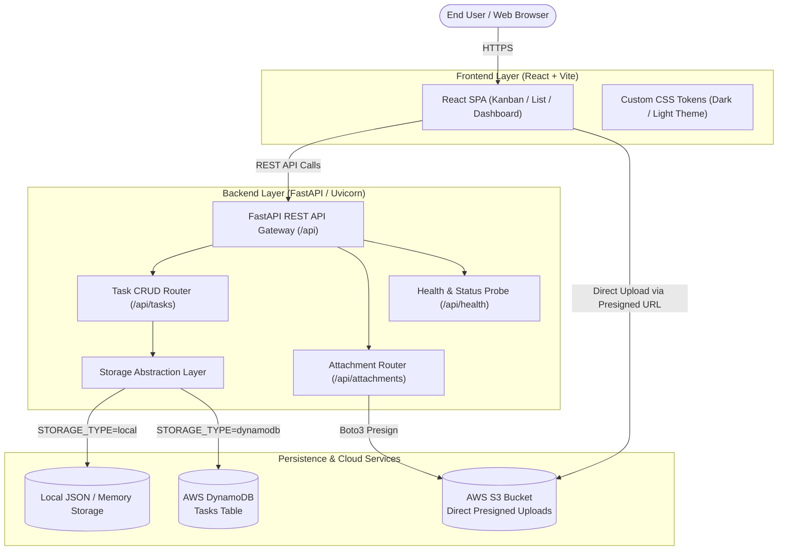
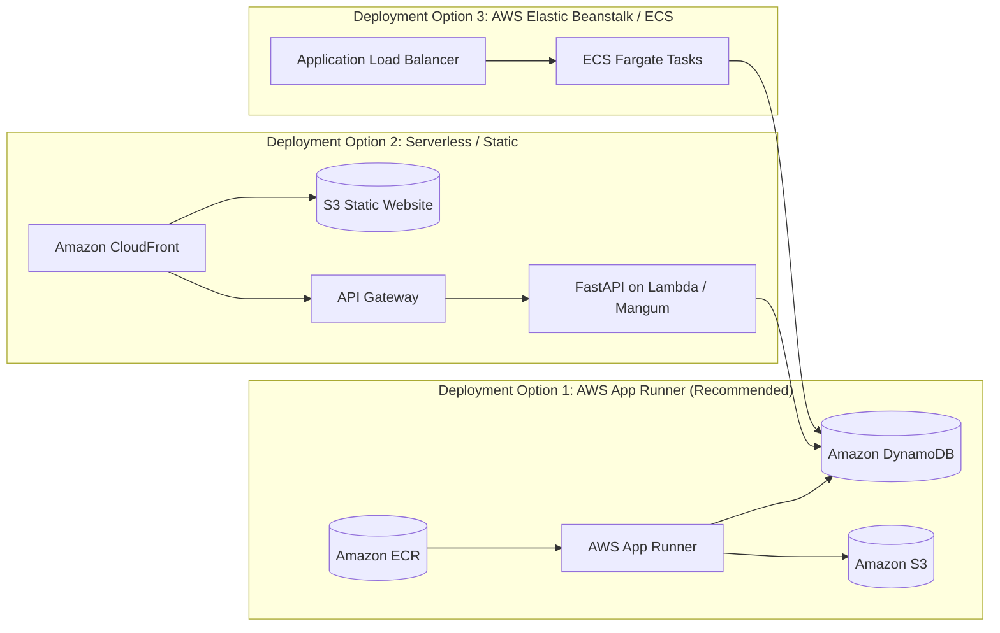

# Cloud-Based Task Manager: Architecture & Code Review Document

**Project Name:** Cloud-Based Task Manager  
**Target Cloud Platform:** Amazon Web Services (AWS)  
**Frontend Stack:** React 19 + Vite (Modern Vanilla CSS Design System)  
**Backend Stack:** Python 3.14 + FastAPI + Uvicorn + Pydantic  
**Cloud Services:** Amazon DynamoDB, Amazon S3, AWS App Runner / ECS, AWS CloudFormation / Terraform  
**Document Version:** 1.0.0  
**Status:** In Progress / Review Stage  

---

## 1. Executive Summary

The **Cloud-Based Task Manager** is a scalable, cloud-native project management web application. It is engineered with dual operational modes:
1. **Local Developer Mode (Zero-Config)**: Runs out-of-the-box using local persistence without requiring AWS credentials, Docker, or external cloud infrastructure.
2. **AWS Production Cloud Mode**: Seamlessly switches to native AWS services—utilizing **Amazon DynamoDB** for scalable NoSQL storage and **Amazon S3** with presigned URL transfers for secure attachment management.

The architecture decouples the presentation layer (**React + Vite SPA**) from the microservice API layer (**Python FastAPI ASGI**), offering containerization readiness for **AWS App Runner** or **AWS ECS Fargate**.

---

## 2. System Architecture Diagram



---

## 3. Technology Stack Breakdown

| Layer | Selected Technology | Rationale & Trade-offs |
|---|---|---|
| **Frontend Framework** | **React + Vite** | Instant HMR, lightweight bundle size, rich ecosystem, simple AWS S3/CloudFront or containerized delivery. |
| **Styling & Theme** | **Vanilla CSS (Design Tokens)** | High flexibility, zero heavy third-party CSS overhead, native glassmorphism, responsive CSS grid/flexbox, dark & light theme tokens. |
| **Backend Framework** | **Python + FastAPI** | High-throughput async ASGI architecture, strict request/response data contracts via Pydantic, automated OpenAPI / Swagger documentation (`/docs`). |
| **Cloud SDK** | **AWS Boto3 & Botocore** | Official AWS SDK for Python with native connection pooling, credential provider chaining, and retry policies. |
| **Database** | **Amazon DynamoDB** (Cloud) / **JSON Engine** (Local) | Single-digit millisecond latency at scale, fully managed serverless NoSQL, zero database maintenance overhead. |
| **Object Storage** | **Amazon S3** | Industry-standard durable object storage with direct client-to-S3 presigned PUT operations (reducing backend bandwidth). |
| **Infrastructure as Code** | **CloudFormation & Terraform** | Deterministic, version-controlled cloud resource provisioning across any AWS account. |

---

## 4. Component & Module Architecture

### 4.1 Frontend Component Hierarchy
```
App.jsx
├── Navbar.jsx (Theme Switch, Search, Quick Add, Cloud Status Badge)
├── StatsOverview.jsx (Total, In-Progress, Overdue, Completion Rate)
├── FilterBar.jsx (Status Filter, Priority Filter, View Mode Toggle: Kanban vs List)
├── View Container:
│   ├── KanbanBoard.jsx
│   │   ├── KanbanColumn (Backlog)
│   │   │   └── TaskCard.jsx (Priority badge, checklist progress, due date countdown)
│   │   ├── KanbanColumn (In Progress)
│   │   ├── KanbanColumn (In Review)
│   │   └── KanbanColumn (Completed)
│   └── TaskListView.jsx (Table/grid view with sortable headers)
└── TaskModal.jsx (Create / Edit Task Form with Subtask Checklist & Tag Editor)
```

### 4.2 Backend API Specifications

| Method | Endpoint | Description | Request Body / Query | Response |
|---|---|---|---|---|
| `GET` | `/api/health` | Service health, active storage provider & AWS region | None | `HealthStatus` |
| `GET` | `/api/tasks` | Fetch tasks with optional filters | `?status=...&priority=...&search=...` | `List[TaskOut]` |
| `GET` | `/api/tasks/stats` | Aggregated analytics & KPI counters | None | `TaskStats` |
| `GET` | `/api/tasks/{id}` | Get single task detail | None | `TaskOut` |
| `POST` | `/api/tasks` | Create new task | `TaskCreate` | `TaskOut` (201) |
| `PUT` | `/api/tasks/{id}` | Update existing task | `TaskUpdate` | `TaskOut` |
| `PATCH`| `/api/tasks/{id}/status` | Move task status (for drag-and-drop) | `{"status": "in-progress"}` | `TaskOut` |
| `DELETE`| `/api/tasks/{id}` | Remove task | None | 204 No Content |
| `POST` | `/api/attachments/presign-upload` | Generate S3 presigned PUT URL | `{"filename": "spec.pdf"}` | `PresignedPayload` |

---

## 5. AWS Cloud Architecture & Infrastructure as Code

### 5.1 Amazon DynamoDB Schema Design
- **Table Name**: `CloudTasks`
- **Partition Key (`PK`)**: `id` (String - UUID / Unique task identifier)
- **Attribute Definitions**:
  - `title` (String): Task title
  - `description` (String): Task description
  - `status` (String): `backlog` | `in-progress` | `in-review` | `completed`
  - `priority` (String): `low` | `medium` | `high` | `urgent`
  - `dueDate` (String, ISO 8601 Date: `YYYY-MM-DD`)
  - `tags` (List of Strings)
  - `subtasks` (List of Maps: `{ id, text, completed }`)
  - `attachments` (List of Maps: `{ id, filename, fileUrl, fileSize }`)
  - `createdAt` (String, ISO 8601 Timestamp)
  - `updatedAt` (String, ISO 8601 Timestamp)
- **Billing Mode**: `PAY_PER_REQUEST` (On-Demand pricing; zero cost when idle).

### 5.2 Amazon S3 Storage Architecture
- **Bucket Purpose**: Encrypted storage for task attachments and media assets.
- **Access Model**: Public access blocked by default.
- **Upload Flow**:
  1. Client requests presigned upload URL from FastAPI backend.
  2. Backend signs a temporary PUT URL with 15-minute expiration using IAM credentials.
  3. Client uploads the file directly to S3 via HTTP PUT (bypassing backend server resources).
- **CORS Configuration**:
  ```json
  [
    {
      "AllowedHeaders": ["*"],
      "AllowedMethods": ["PUT", "GET", "HEAD"],
      "AllowedOrigins": ["*"],
      "ExposeHeaders": ["ETag"]
    }
  ]
  ```

### 5.3 Deployment Strategies on AWS



1. **Option 1: AWS App Runner (Fully Managed Container)**
   - Build container with multi-stage Dockerfile.
   - Push to Amazon ECR.
   - Deploy to App Runner: automatic SSL, auto-scaling from 1 to N instances, zero server maintenance.
2. **Option 2: AWS ECS Fargate**
   - Ideal for enterprise VPC environments requiring private subnets and custom domain routing via ALB.
3. **Option 3: AWS Elastic Beanstalk (Python Platform)**
   - Direct ZIP upload or Git-based deployment for standard Python WSGI/ASGI environments.

---

## 6. Security, Resilience & Best Practices

| Category | Measure | Implementation |
|---|---|---|
| **Authentication & IAM** | Least-Privilege IAM Policy | CloudFormation template provides IAM roles granting only `dynamodb:*` on the specific table ARN and `s3:*` on the designated bucket ARN. |
| **Credential Safety** | Default Credential Provider Chain | Code never hardcodes secrets; uses standard AWS environment variables, instance profiles, or ECS task execution roles. |
| **Data Validation** | Pydantic Schema Enforcement | Strict typing on all API inputs prevents SQL/NoSQL injection and rejects malformed payloads. |
| **Upload Security** | S3 Presigned URLs with Short TTL | Direct client-to-S3 uploads have a 15-minute time-to-live, preventing unauthorized reusable links. |
| **Container Security** | Non-Root User & Multi-Stage Build | Production Docker container runs under an unprivileged user (`appuser`), minimizing host attack surface. |
| **Fault Tolerance** | Automatic Fallback Engine | If AWS credentials or DynamoDB table are unavailable in dev, the app gracefully falls back to local file storage. |

---

## 7. Review Checklist & Verification Matrix

- [x] **Backend Architecture**: Async FastAPI with Pydantic validation & Uvicorn ASGI server.
- [x] **Storage Abstraction**: Seamless toggle between local JSON and AWS DynamoDB (`STORAGE_TYPE`).
- [x] **S3 Integration**: Boto3 presigned URL generator for secure file attachments.
- [x] **Frontend Architecture**: Modern React + Vite with clean component composition and Vanilla CSS design tokens.
- [x] **Interactive Kanban UI**: Drag-and-drop column workflow with optimistic UI updates.
- [x] **Infrastructure as Code**: Production-ready AWS CloudFormation and Terraform definitions.
- [x] **Containerization**: Multi-stage Dockerfile for AWS App Runner, ECS, or EC2.
- [x] **Automated Testing**: Unit and integration test suite (`pytest`) verifying endpoints and storage adapters.

---

## 8. Next Steps for Execution

1. **Complete Server Runner Script & Automated Pytest Suite**: Finalize `run.py` and run automated endpoint validation tests.
2. **Implement React Frontend Components**: Build the responsive Kanban board, stats overview, filter controls, and task modal.
3. **Assemble Infrastructure Assets**: Provide the ready-to-deploy CloudFormation template, Terraform files, and Dockerfile.
4. **End-to-End Verification**: Launch both frontend and backend locally, verify all user interactions via browser testing, and produce the final deployment walkthrough.
