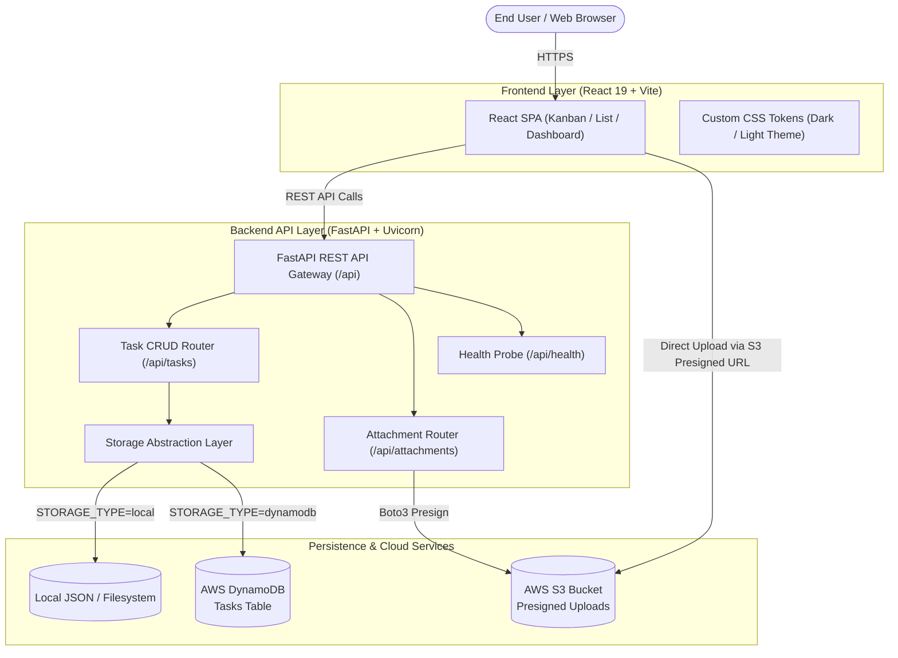

# ☁️ Cloud-Based Task Management System

[](https://fastapi.tiangolo.com)
[](https://react.dev/)
[](https://vitejs.dev/)
[](https://aws.amazon.com/)
[](https://www.docker.com/)
[](https://opensource.org/licenses/MIT)

A scalable, cloud-native project and task management web application engineered with a modern **React 19** frontend and a high-performance **Python FastAPI** backend. Built to support dual operational modes: **Zero-Config Local Mode** for instant local development and **AWS Production Cloud Mode** utilizing **Amazon DynamoDB** and **Amazon S3**.

---

## 🌟 Key Features

- **Interactive Kanban & List Views**: Drag-and-drop workflow stages (`Backlog`, `In Progress`, `In Review`, `Completed`) with instant status transitions.
- **Dual-Mode Persistence Architecture**:
  - **Local Mode (Default)**: Out-of-the-box local JSON storage (`server/data/tasks.json`) and local file storage with zero cloud dependencies.
  - **AWS Cloud Mode**: Seamless switch to **Amazon DynamoDB** for NoSQL data persistence and **Amazon S3** for secure, presigned attachment uploads.
- **Role-Based Experience**: Tailored views and dashboards for both **Managers** (sprint tracking, team assignments, analytics) and **Employees** (personal tasks, status updates).
- **Rich Task Metadata**: Priority badges, checklist subtasks, tag categorization, due dates with countdowns, and attachment uploads.
- **Modern Vanilla CSS Design System**: Lightweight, responsive interface with custom CSS design tokens, smooth micro-interactions, and dark/light mode support.
- **Automated API Documentation**: Interactive Swagger (`/docs`) and ReDoc (`/redoc`) API explorers powered by FastAPI and Pydantic.
- **Production Containerization**: Multi-stage `Dockerfile` and `docker-compose.yml` for unified local or cloud deployment.
- **Infrastructure as Code (IaC)**: Ready-to-deploy **AWS CloudFormation** and **Terraform** scripts.

---

## 🏗️ System Architecture



---

## 🛠️ Technology Stack

| Layer | Technologies | Description |
|---|---|---|
| **Frontend** | React 19, Vite, Lucide React | Single Page Application with fast HMR and responsive design |
| **Styling** | Vanilla CSS (CSS Variables) | Modern design tokens, glassmorphism, responsive grid/flexbox |
| **Backend** | Python 3.12+, FastAPI, Uvicorn | Async ASGI microservice framework with Pydantic validation |
| **Cloud Services** | Amazon DynamoDB, Amazon S3, Boto3 | Serverless NoSQL database and secure cloud object storage |
| **DevOps & IaC** | Docker, Docker Compose, Terraform, CloudFormation | Containerization and automated AWS infrastructure provisioning |
| **Testing** | Pytest, HTTPX | Automated unit and integration testing suite |

---

## 📁 Project Structure

```text
├── client/                     # Frontend Application (React 19 + Vite)
│   ├── public/                 # Static assets
│   ├── src/
│   │   ├── components/         # React UI Components (Kanban, List, Modals, Auth)
│   │   ├── styles/             # Modular CSS stylesheets and design tokens
│   │   ├── App.jsx             # Main Application Entry Point
│   │   └── main.jsx            # React DOM mounting
│   ├── package.json
│   └── vite.config.js
├── server/                     # Backend Application (FastAPI + Python)
│   ├── app/
│   │   ├── routers/            # API endpoints (tasks, attachments, health)
│   │   ├── services/           # Storage layer (local JSON & DynamoDB / S3)
│   │   ├── models/             # Pydantic data validation schemas
│   │   └── main.py             # FastAPI app factory and middleware
│   ├── data/                   # Local storage data directory (tasks.json)
│   ├── uploads/                # Local attachments upload folder
│   ├── tests/                  # Pytest test cases
│   ├── requirements.txt        # Python backend dependencies
│   └── run.py                  # ASGI server startup entry point
├── infrastructure/             # Infrastructure as Code
│   ├── cloudformation.yaml     # AWS CloudFormation template (DynamoDB + S3)
│   └── terraform/              # Terraform configurations for AWS resources
├── .env.example                # Example environment variables template
├── Dockerfile                  # Container build instructions
├── docker-compose.yml          # Multi-container orchestration
├── package.json                # Root automation scripts
└── README.md                   # Project documentation
```

---

## 🚀 Quick Start Guide

### Prerequisites

- **Node.js** (v18.0 or newer) & **npm**
- **Python** (v3.12 or newer) & **pip**
- *(Optional)* **Docker & Docker Compose**
- *(Optional)* **AWS CLI** configured (only for AWS Cloud Mode)

---

### Option 1: Local Development (Recommended)

#### 1. Clone the Repository
```bash
git clone https://github.com/Sathish0969/Cloudbasedtaskmanagementsystem.git
cd Cloudbasedtaskmanagementsystem
```

#### 2. Configure Environment Variables
Copy `.env.example` to `.env`:
```bash
cp .env.example .env
```
*(By default, `STORAGE_TYPE=local` runs with zero external configuration!)*

#### 3. Setup and Run Backend
```bash
# Navigate to server directory
cd server

# Create and activate virtual environment
python -m venv .venv
# On Windows:
.venv\Scripts\activate
# On macOS/Linux:
source .venv/bin/activate

# Install dependencies
pip install -r requirements.txt

# Start FastAPI server (Runs on http://localhost:5000)
python run.py
```

#### 4. Setup and Run Frontend
Open a new terminal window:
```bash
# Navigate to client directory
cd client

# Install frontend dependencies
npm install

# Start Vite dev server (Runs on http://localhost:5173)
npm run dev
```

Open your browser and navigate to **`http://localhost:5173`**.

---

### Option 2: Run with Docker Compose

Run the entire full-stack application with a single command:
```bash
docker-compose up --build
```
The application will be accessible at:
- Frontend UI: `http://localhost:5173` (or mapped port)
- Backend API & Swagger Docs: `http://localhost:5000/docs`

---

## ⚙️ Environment Configuration

| Variable | Default | Description |
|---|---|---|
| `PORT` | `5000` | Backend API server listening port |
| `HOST` | `0.0.0.0` | Backend network bind interface |
| `STORAGE_TYPE` | `local` | Storage mode: `local` (JSON + disk) or `dynamodb` (AWS) |
| `AWS_REGION` | `us-east-1` | Target AWS region (when using DynamoDB/S3) |
| `AWS_ACCESS_KEY_ID` | *optional* | AWS Access Key ID |
| `AWS_SECRET_ACCESS_KEY` | *optional* | AWS Secret Access Key |
| `DYNAMODB_TABLE_NAME` | `CloudTasks` | Name of the DynamoDB table |
| `S3_BUCKET_NAME` | `cloud-task-manager-attachments` | Name of the S3 bucket for task files |

---

## ☁️ AWS Cloud Deployment

To deploy native AWS cloud resources:

### Using AWS CloudFormation
```bash
aws cloudformation create-stack \
  --stack-name task-manager-stack \
  --template-body file://infrastructure/cloudformation.yaml \
  --capabilities CAPABILITY_IAM
```

### Using Terraform
```bash
cd infrastructure/terraform
terraform init
terraform plan
terraform apply
```

Once provisioned, update your `.env` file with `STORAGE_TYPE=dynamodb` and your AWS credentials.

---

## 🧪 Running Automated Tests

Run the backend unit and integration test suite with `pytest`:
```bash
# From the project root
pytest server/tests -v
```

---

## 📖 API Documentation

When the backend server is running, explore the interactive API documentation:
- **Interactive Swagger UI**: [http://localhost:5000/docs](http://localhost:5000/docs)
- **ReDoc UI**: [http://localhost:5000/redoc](http://localhost:5000/redoc)

### Key Endpoints:
- `GET  /api/health` - Health check and storage engine status
- `GET  /api/tasks` - Fetch all tasks with optional status/priority filtering
- `POST /api/tasks` - Create a new task
- `PUT  /api/tasks/{task_id}` - Update task details or move status
- `DELETE /api/tasks/{task_id}` - Delete a task
- `POST /api/attachments/upload` - Upload file attachment (or generate S3 presigned URL)

---

## 🤝 Git Workflow & Team Collaboration

If you and your team members/friends are collaborating on this project, follow this standardized Git workflow:

### 1. Adding Collaborators on GitHub
The repository owner (`sathish0969`) must grant write access to team members:
1. Go to the repository **[Settings > Collaborators](https://github.com/Sathish0969/Cloudbasedtaskmanagementsystem/settings/access)**.
2. Click **Add people**.
3. Enter your friend's GitHub username or email address and send the invite.
4. Your friend must check their email or open `https://github.com/Sathish0969/Cloudbasedtaskmanagementsystem/invitations` to accept the invite.

---

### 2. How Friends Clone and Set Up the Project
```bash
# Clone the repository
git clone https://github.com/Sathish0969/Cloudbasedtaskmanagementsystem.git
cd Cloudbasedtaskmanagementsystem

# Configure personal Git credentials
git config user.name "Your Name"
git config user.email "your.email@example.com"
```

---

### 3. Daily Workflow: Pull, Update & Push

Always pull the latest changes before starting work to avoid merge conflicts:

```bash
# 1. Fetch latest changes from the main branch
git checkout main
git pull origin main

# 2. Create your own feature branch (Recommended)
git checkout -b feature/task-update

# 3. Make your code changes, then verify status
git status

# 4. Stage modified files
git add .

# 5. Commit with a meaningful message
git commit -m "feat: added new task filter component"

# 6. Push your branch to GitHub
git push origin feature/task-update
```

*(You can also merge and push directly to `main` if working on a shared branch):*
```bash
git add .
git commit -m "update: project progress"
git push origin main
```

---

## 👥 Project Team & Contributors

| Member | Role | GitHub |
|---|---|---|
| **Sathish S** | Project Lead & Cloud Architect | [@Sathish0969](https://github.com/Sathish0969) |
| **Sabarinathan V** | Full-Stack Developer | [@sabarinathanfwff](https://github.com/sabarinathanfwff) |

---

## 📄 License

This project is licensed under the [MIT License](LICENSE).

